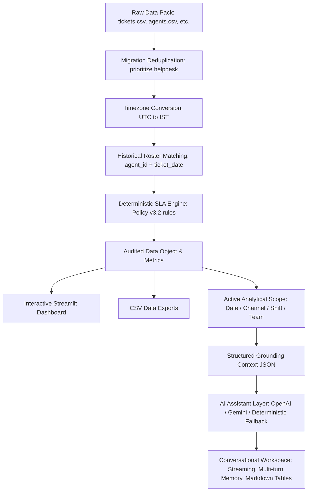

# Vireo Audio — Support SLA Control Room

An auditable, deterministic support operations analytics tool and dashboard built for the **Vireo Audio Support Tickets (Set D)** assessment.

The application delivers the primary business requirement:
> **"A weekly first-response SLA breach report by agent and shift."**

It combines deterministic data pipeline logic, strict adherence to Vireo's Customer Support Operating Policy v3.2, historical roster reconciliation, leadership claims verification, and an explanation-only AI assistant.

---

## 1. Prerequisites

- **Python:** 3.10 to 3.14
- **Operating System:** macOS, Linux, or Windows
- **Git**

---

## 2. Installation & Clean-Machine Setup

Clone the repository and set up a clean virtual environment:

```bash
# Clone and enter workspace
cd vireo_support_app

# Create virtual environment
python3 -m venv .venv

# Activate virtual environment
source .venv/bin/activate       # On Windows: .venv\Scripts\activate

# Install dependencies
pip install -r requirements.txt
```

---

## 3. Running the Application

To launch the interactive Streamlit dashboard:

```bash
streamlit run app.py
```

The application will start locally at `http://localhost:8501`.

### Optional AI Operations Assistant Setup
The application is 100% functional without an AI API key (using built-in deterministic operations intelligence with conversation memory). To enable a live LLM explanation layer with streaming responses:

1. Copy the template configuration file:
   ```bash
   cp .env.example .env
   ```
2. Configure your chosen provider in `.env` or in your system environment:
   ```bash
   # Option A: OpenAI (GPT-4o-mini / GPT-4o)
   LLM_PROVIDER=openai
   OPENAI_API_KEY="sk-..."
   OPENAI_MODEL=gpt-4o-mini

   # Option B: Google Gemini (Gemini 1.5 Flash / Pro)
   LLM_PROVIDER=gemini
   GEMINI_API_KEY="AIzaSy..."
   GEMINI_MODEL=gemini-1.5-flash
   ```
3. Run the application:
   ```bash
   streamlit run app.py
   ```

---

## 4. Running the Test Suite

The test suite validates data integrity, policy boundaries, timezone math, and historical roster matching:

```bash
pytest -v
```

All 14 automated tests run in under 1 second.

---

## 5. Data Files & Directory Structure

All data files are located in the relative `data/` directory and loaded without hard-coded absolute paths:

- `data/tickets.csv` — 11,816 raw support tickets (1 Jan 2025 – 30 Jun 2026), API export in UTC.
- `data/agents.csv` — 46 historical roster assignment rows for 44 agents.
- `data/customers.csv` — Customer registry (tier, city, Care+ status).
- `data/orders.csv` — Order transaction history.
- `data/products.csv` — Product catalog with SKUs and unit costs.
- `data/support-policy.pdf` — Vireo Support Operating Policy v3.2 (effective 1 April 2025).
- `data/email-thread.txt` — Stakeholder context from Neha, Priya, Arjun, and Sameer.

---

## 6. Architecture & Design Principles



### Technology Decisions
- **Core Engine:** Python + Pandas for fast, auditable vector operations.
- **Visuals:** Streamlit + Plotly Express for clean, zero-bloat operations dashboards with custom CSS floating shell and ambient depth.
- **Testing:** Pytest for regression and boundary testing.
- **Architectural Exclusions:** Deliberately discarded React, Next.js, external databases (PostgreSQL), LangChain, RAG, and ML prediction. Operations tools require transparent, auditable business logic without unnecessary infrastructure.

---

## 7. Business Methodology & Policy Rules

### A. First-Response SLA & Credit Rule (Policy §3)
- First response is the first reply by a human agent measured from ticket creation.
- Channel targets:
  - **Chat:** 15 minutes
  - **Voice callback:** 2 hours (120 minutes)
  - **Social:** 4 hours (240 minutes)
  - **Email:** 8 hours (480 minutes)
- **Exact Boundary Behavior:** A breach occurs strictly when $\text{response\_minutes} > \text{target\_minutes}$. Exactly at target ($\le$) is compliant (55 tickets in dataset).
- Every breach creates a ₹350 store-credit exposure. Breaches are attributed to the resolving agent.

### B. Migration Deduplication Rule (Policy §9)
- 616 ticket IDs appear twice due to Freshdesk migration re-imports.
- Deduplication evaluates `source_system` and retains the `helpdesk` record over `legacy_fd`.

### C. Timezone Rule (Policy §7 & §9)
- Helpdesk API exports timestamps in UTC.
- All timestamps are converted to `Asia/Kolkata` (IST) for calendar dates, Monday–Sunday weekly grouping, and shift attribution. Elapsed durations are identical in UTC and IST.

### D. Historical Roster Matching Rule (Policy §7)
- The roster contains 46 rows for 44 agents.
- Tickets are matched using `agent_id` and ticket IST creation date: $\text{from\_date} \le \text{date} \le \text{to\_date}$ (inclusive).
- The June 2025 Indore reshuffle (agents A3002 and A3003 moving from Night to Day shift on 2025-06-30) is correctly respected. Unmatched roster tickets: 0.

### E. CSAT Normalization Rule (Policy §8)
- Legacy Freshdesk used score `0` for unreturned surveys.
- All `0` scores are converted to `NaN`. Valid scores (1–5) are preserved, giving 4,993 responses (44.58% response rate, exactly matching policy expectation of ~45%).

### F. Tier 2 Separation (Policy §6)
- Tier 2 Escalations & Warranty cases are multi-touch and measured in resolution days, not weekly volume. Tier 2 agents are strictly separated in reporting to prevent unfair volume comparisons.

---

## 8. Verified Operational Baseline

| Dimension | Category | Ticket Volume | SLA Breaches | Breach Rate | SLA Credit Exposure |
| :--- | :--- | :--- | :--- | :--- | :--- |
| **Total** | **All Tickets** | **11,200** | **2,440** | **21.79%** | **₹854,000** |
| **Channel** | Chat | 4,959 | 1,368 | 27.59% | ₹478,800 |
| | Email | 3,647 | 745 | 20.43% | ₹260,750 |
| | Social | 1,106 | 243 | 21.97% | ₹85,050 |
| | Voice | 1,488 | 84 | 5.65% | ₹29,400 |
| **Shift** | Morning (06:00–14:00) | 6,264 | 2,018 | 32.22% | ₹706,300 |
| | Day (14:00–22:00) | 4,668 | 393 | 8.42% | ₹137,550 |
| | Night (22:00–06:00) | 268 | 29 | 10.82% | ₹10,150 |

---

## 9. AI Operations Assistant Architecture & Guardrails

The application features a dedicated **AI Operations Assistant** delivering a ChatGPT/Gemini-grade conversational experience embedded natively within the Vireo Support Operations platform.

### A. Core Conversational Features
- **Multi-Turn Context Retention:** Maintains conversation memory across turns (e.g. asking *"Why are breaches high?"* $\to$ *"What about the morning shift?"* $\to$ *"How much credit exposure does that represent?"* $\to$ *"Compare that with email."*).
- **Streaming Responses:** Real-time token streaming with visual generation feedback.
- **Interactive Controls:** `+ New Chat`, `Clear Chat`, `↻ Regenerate response`, `Copy response`, and one-click follow-up inquiry chips.
- **Rich Markdown Formatting:** Headings, structured comparison tables, bulleted operational summaries, and citation chips.
- **Empty State & Quick Prompts:** 8 curated operational prompts covering SLA breach drivers, shift comparisons, credit exposure, and manager-ready findings.

### B. Verified Data Grounding
The AI is strictly grounded in verified Python/Pandas calculations:
$$\text{Raw CSV} \longrightarrow \text{Python/Pandas Pipeline} \longrightarrow \text{Verified Metrics} \longrightarrow \text{Structured Context} \longrightarrow \text{LLM / Engine} \longrightarrow \text{Answer}$$

- The LLM **never** calculates metrics or queries raw CSV rows directly.
- All numbers cited in answers (11,200 tickets, 2,440 breaches, 21.79% rate, ₹854,000 credit exposure, shift distributions) match the audited operational baseline exactly.
- **Filter-Aware Context:** When active filters (Date, Channel, Shift, Team) are selected in the sidebar, the assistant automatically incorporates the active analytical scope into its structured grounding.

### C. Provider Abstraction & Fallback Mode
- Supports both **OpenAI** (`OPENAI_API_KEY`) and **Google Gemini** (`GEMINI_API_KEY`) configured via `.env` or system environment variables.
- **Zero-Key Graceful Fallback:** If no API key is configured, the application displays a clean, professional status notice (*"AI provider is not configured. Add an API key to the environment configuration to enable live AI conversations."*), and operates seamlessly using its internal verified deterministic intelligence engine. The core dashboard and the conversational interface remain 100% operational without crashing.

### D. Operational Guardrails
1. **No Data Fabrication:** The assistant only quotes verified pipeline figures and explicitly states when data is insufficient.
2. **Q4 Headcount Freeze Enforced:** Strict prohibition against recommending hiring additional agents; recommendations focus on 05:30 IST shift staggering, cross-skilling, and queue triage.
3. **Policy §3 Grounding:** SLA credit calculations use the exact ₹350 per breach penalty.
4. **15% Scenario Distinction:** The 15% breach rate target is clearly identified as an illustrative financial modeling scenario, not an official policy threshold.
5. **Neutral Agent Evaluations:** Factual reporting of ticket and breach counts without punitive or derogatory language.
6. **Zero Emojis:** Pure SVG vector iconography throughout all navigation, status cards, and chat bubbles.

---

## 10. Deliverables & Outputs

- `outputs/data-audit.md` — Complete data audit, validation checks, and exceptions log.
- `outputs/memo.md` — One-page nontechnical executive memo to Neha Kulkarni.
- `outputs/demo-script.md` — Timed 3-minute video presentation script.
- `outputs/submission-form.md` — Completed assessment submission form.

---

## 11. Assumptions & Limitations

1. **Historical P&L Claims:** Ticket data begins on 1 January 2025. Arjun's claim that SLA credit costs tripled since "last summer" (summer 2024) cannot be established from the ticket data alone (*"Available ticket data does not establish the historical P&L comparison"*).
2. **Headcount Constraint:** Per Arjun's email, hiring is frozen through Q4; all recommendations focus on shift scheduling and queue handoff optimizations.
3. **Credit Liability vs Cash Impact:** Avoiding an SLA breach avoids a ₹350 store-credit liability. Actual P&L cash savings depend on customer wallet redemption behavior.

